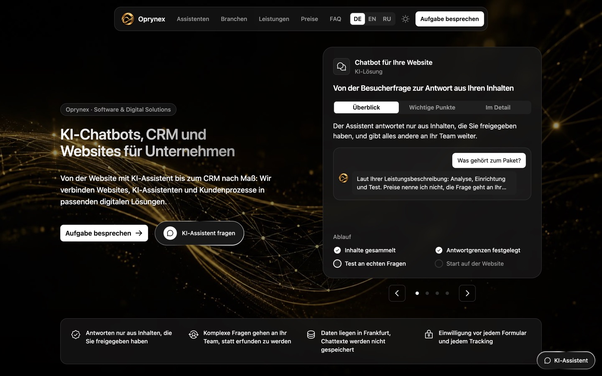
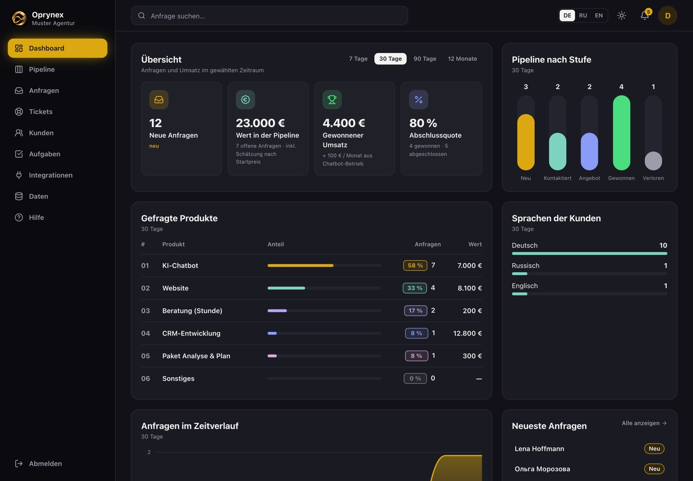
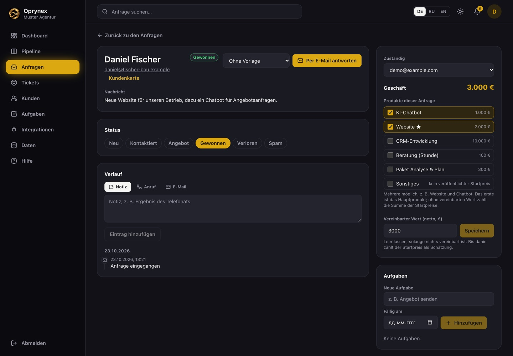
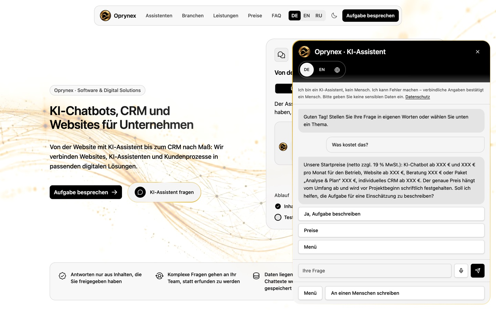
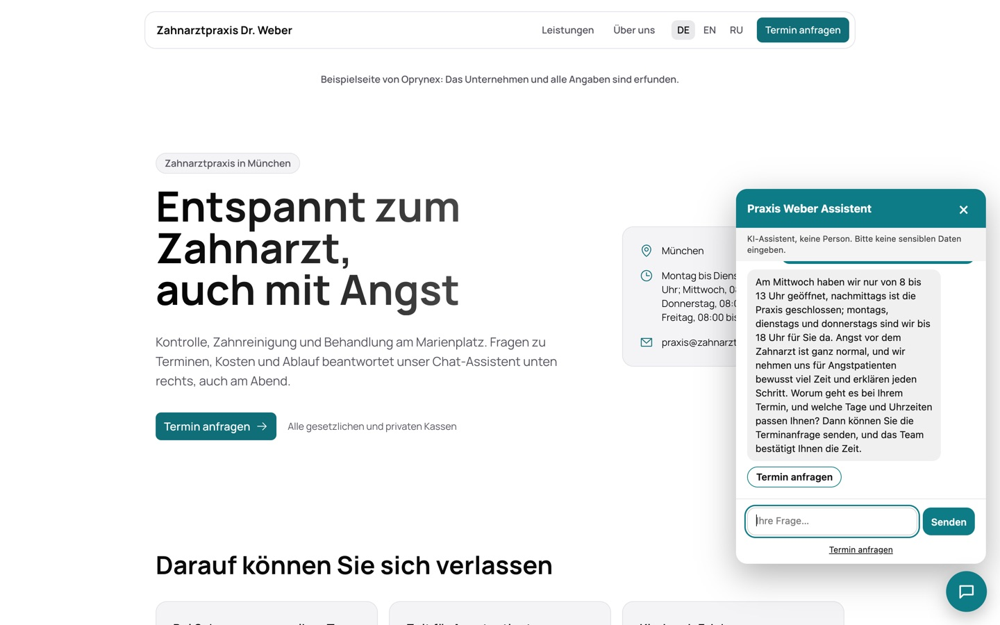
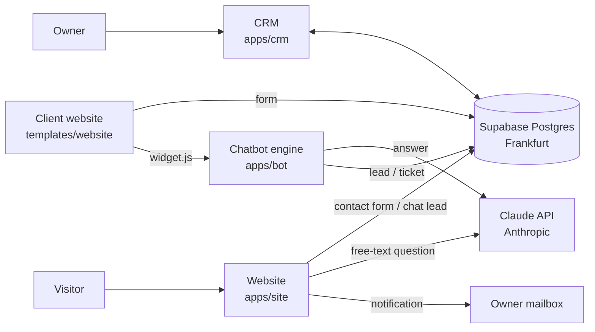

# Oprynex — website, AI chat, CRM and chatbot engine

A complete small-business platform, designed, built and run by one developer between October and November 2026:

- **Website** with a landing page, 29 pages, three languages, a contact form and an AI chat that answers in 20 languages.
- **CRM** where every request from the website, the chat and client websites arrives, with pipeline, tasks, tickets and statistics.
- **Chatbot engine** that puts an AI assistant on any client website with one line of code.
- **Website template** for client websites: one configuration file per client, legal texts generated from it.
- **One database** (Postgres on Supabase in Frankfurt) with 26 migrations and row level security on every table.

Everything ran in production on Cloudflare Workers under its own domain. The project is no longer developed; this repository keeps the full source, the database schema, the documentation and screenshots of every screen.



| CRM dashboard | Request with several products |
|---|---|
|  |  |

| Website chat: prepared answers | Client chatbot: a real AI answer |
|---|---|
|  |  |

More in the [screenshot gallery](docs/screenshots/README.md).

## How the parts fit together



Each box on the left is a Cloudflare Worker. The browser of the CRM talks to the database directly with a public key; row level security decides what each signed-in member may read or change. Websites and the chatbot engine never hold the database's secret key: they call a few database functions that check a per-site token. Details in [docs/architecture.md](docs/architecture.md).

## Technology

| Area | Used |
|---|---|
| Language | **TypeScript** everywhere (React front ends, server functions, Workers); **SQL** for the database; plain **JavaScript** for the embeddable chat widget. No Python or Java. |
| Front end | React 19, TanStack Start and Router, TanStack Query, Tailwind CSS 4, Vite 8 |
| Hosting | Cloudflare Workers (server-side rendering at the edge), Cloudflare DNS, Email Routing, `send_email` binding |
| Database | Supabase (Postgres 17, Frankfurt): row level security, `SECURITY DEFINER` functions in a private schema, `pg_cron`, `pg_net` |
| AI | Claude API (Anthropic) for the website chat and the client chatbots, with daily quotas and a local fallback |
| Validation | Zod schemas shared by browser and server |
| Tests | Vitest and Testing Library: 413 tests across the projects, including accessibility checks (axe) |
| Tooling | Bun, Wrangler, Drizzle Kit, Claude Code as the AI pair programmer |

## Repository layout

```
apps/
  site/        Public website: landing, offer pages, 14 search guides, AI chat, contact form, legal pages
  crm/         CRM: dashboard, pipeline, requests, customers, tasks, tickets, bots, forms, data export
  bot/         Chatbot engine: one Worker serves every client bot (widget.js, /v1/bots/:id/chat, /lead)
templates/
  website/     Template for client websites: one config file per client, legal texts generated from it
database/
  migrations/  26 SQL migrations: 0000–0004 from the website, 0100–0120 from the CRM
docs/          Architecture, hosting, database, AI chat, chatbot engine, security, how it was built, screenshots
```

## Try it locally

You need [Bun](https://bun.sh). The quickest look is the CRM in demo mode: no database, no sign-in, invented data in memory.

```bash
cd apps/crm
bun install
bun run dev:demo        # http://localhost:8090/dashboard
```

The website runs without a database too; the contact form and the AI chat need the values from `.env.example`.

```bash
cd apps/site
bun install
bun run dev             # http://localhost:8080
```

To run everything against your own database, create a Supabase project, apply `database/migrations` in order and fill in the `.env.example` files. [docs/hosting.md](docs/hosting.md) lists every secret and every deployment step.

## Documentation

- [Architecture](docs/architecture.md): components, data flow, why each piece is where it is
- [Hosting and deployment](docs/hosting.md): Cloudflare Workers, domain, email, secrets, costs
- [Database](docs/database.md): tables, row level security, functions, migrations
- [AI chat on the website](docs/ai-chat.md): prompt, quotas, prepared answers, privacy
- [Chatbot engine for client websites](docs/chatbot-engine.md): widget, tokens, bot types
- [Security and data protection](docs/security.md)
- [How it was built](docs/how-it-was-built.md): the timeline from the first prototype to production

## Kurz auf Deutsch

Oprynex ist eine vollständige Plattform für kleine Unternehmen: eine dreisprachige Website mit KI-Chat, ein CRM für alle Anfragen, eine Chatbot-Engine für Kunden-Websites und eine Vorlage für Kunden-Websites. Alles läuft auf Cloudflare Workers mit einer Supabase-Datenbank in Frankfurt und ist in TypeScript geschrieben. Das Projekt wird nicht weiterentwickelt; dieses Repository zeigt den vollständigen Quellcode, das Datenbankschema und Screenshots aller Bildschirme.

## Author and license

Released under the [MIT License](LICENSE). This is a public demo: every price is shown as "XXX €", the operator in the code and on the screenshots is the placeholder "Max Mustermann, Musterstraße 1, 12345 Musterstadt", and all companies, people and requests in the demo data are invented. The legal texts in the code (Impressum, Datenschutz, AGB, AVV) are examples; they are not legal advice.
