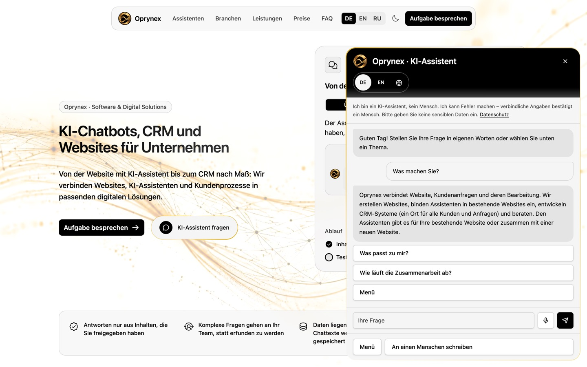
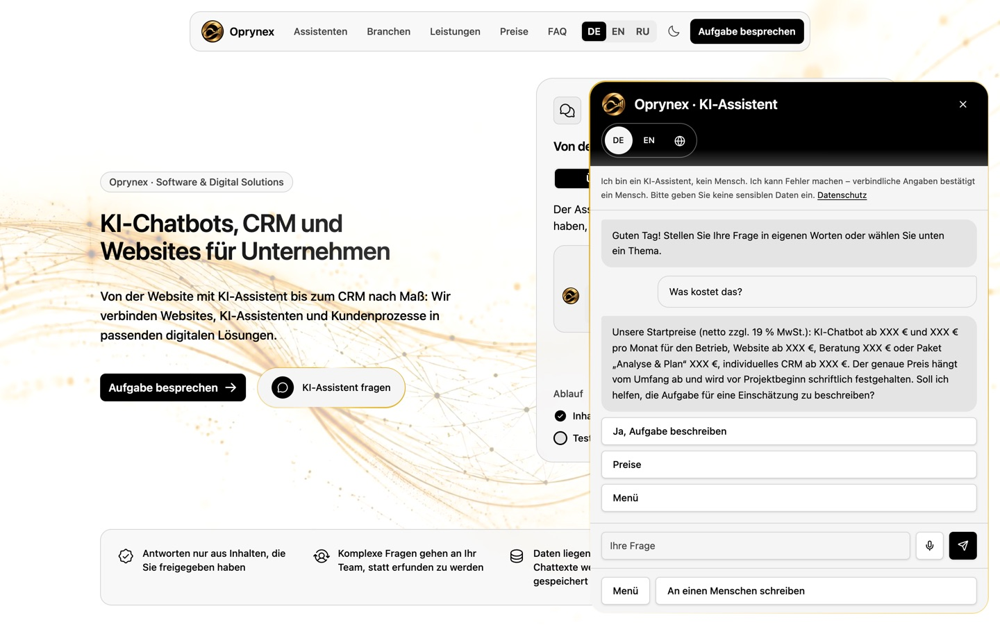

# AI chat on the website

The assistant in the lower right corner of the website combines prepared answers with the Claude API.

| Prepared answer: what we do | Prepared answer: prices (hidden as XXX in this demo) |
|---|---|
|  |  |

## How a message is answered

1. **Buttons and keywords first.** A trilingual registry of prepared scenarios (`apps/site/src/lib/chat-scenarios.ts`) covers the common paths: what Oprynex does, which offer fits, prices, timelines, process, doubts, contact. Keywords in the visitor's text are matched locally; no server call is needed.
2. **Free text goes to Claude.** If no scenario matches, a public server function (`ask-chat.functions.ts`) checks the origin, takes the IP hash, asks the database for quota (`accept_chat_request`: 10 per minute and 60 per day per visitor, 1 500 per day in total) and sends the conversation of this page view to the Claude API with a server-only system prompt (`chat-knowledge.server.ts`).
3. **Structured answer.** The model returns the answer, up to three suggested next buttons and whether a person should take over. The client validates this shape with Zod and drops anything unexpected.
4. **Fallback.** A refusal, a cut-off answer, an exhausted quota or a network error never shows an error to the visitor: the chat answers with the prepared scenario instead.

## The knowledge

The system prompt is assembled at build time from the same registries the pages use: offers and prices, the operator's published contact data, the industries, the assistant types, the rules for consulting by email. So the chat can never quote a price the page does not show. It contains explicit rules: answer in the visitor's language (20 are supported), keep answers short, explain abbreviations, never invent facts, prices or legal terms, say plainly what is not offered, never promise calls or meetings, and treat legal or medical questions with care.

## Privacy

- Message texts are never stored or logged, neither on the server nor in the database. Only counters per IP hash (SHA-256, deleted after 7 days) are kept.
- The chat window says that it is an AI assistant (EU AI Act, Art. 50) and asks not to enter sensitive data.
- Voice input uses the browser's speech recognition only after an inline consent that lasts for the session; dictation is never sent automatically.
- A request from the chat is saved only when the visitor fills in the form inside the chat and consents.

## Model settings

`claude-opus-5-5` with `max_tokens` 4 000; an answer cut off at the limit is treated like a failure and replaced by a prepared answer.
