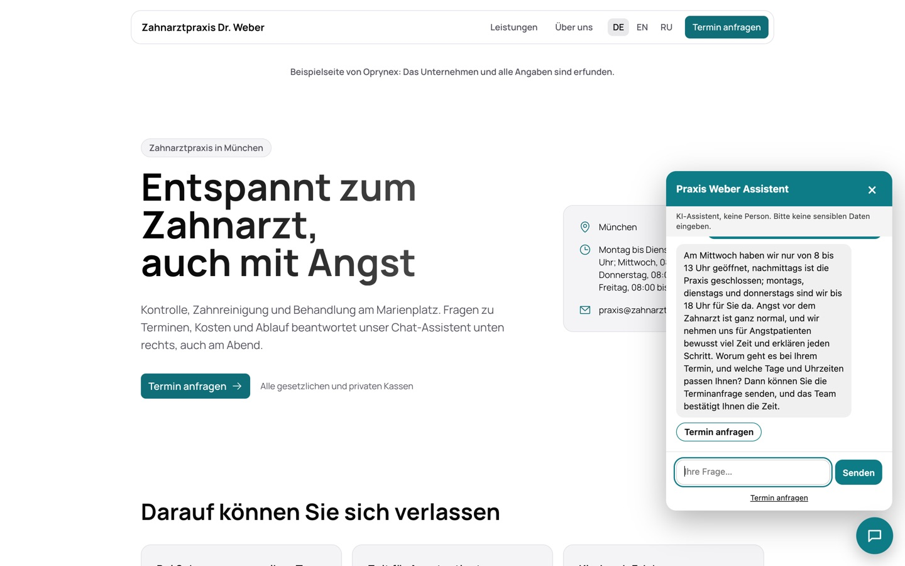

# Chatbot engine for client websites

One Cloudflare Worker (`apps/bot`) serves every client chatbot. A client website embeds one line:

```html
<script src="https://bot.example.workers.dev/widget.js" data-bot="BOT-ID" async></script>
```



The screenshots in [screenshots/chatbot](screenshots/chatbot) show real answers of the engine for an invented dental practice: opening hours and a calm word for anxious patients, a price question answered only from the practice's own knowledge, and an English question answered in English.

## Setting up a bot

In the CRM (Integrations → Bots) the owner creates a bot for a client workspace: name, business description, knowledge text (up to 20 000 characters), greeting, quick replies, colour, languages, the websites allowed to show it, daily limits and the bot type:

| Type | Does |
|---|---|
| `website` | Helps visitors find their way |
| `lead` | Clarifies the need and asks for contact details and company |
| `appointment` | Asks for reason, preferred day and time; the team confirms, nothing is booked automatically |
| `support` | Answers from documentation and opens a ticket instead of a request |
| `shop` | Recommends only products named in the knowledge |
| `cart` | Explains cart, delivery and payment; never sees or changes a cart |

A preview page (`/demo/<id>`) shows the bot on a blank page for sales demos.

## How it is protected

- **Origin check.** Every `/v1` call must come from one of the bot's websites and gets CORS for that site only.
- **Token, not secret key.** The engine holds the public database key and its own random token; the database keeps the token's SHA-256 and the functions `bot_engine_config`, `accept_bot_question`, `accept_bot_lead` and `accept_bot_ticket` compare it on every call.
- **Limits.** Per bot per day, per visitor (IP hash) per minute and day, and a global engine limit, all counted in the database.
- **Closed widget.** The widget is plain JavaScript in a closed Shadow DOM; all visitor and AI text is set with `textContent`, never as HTML.
- **Rules before knowledge.** The bot's rules (`src/prompt.ts`) come first in the prompt; the client's knowledge follows, marked as data, so text in the knowledge cannot override the rules.
- **No stored conversations.** Only counters and the request a visitor sends on purpose are saved.

## Website forms

The same engine serves contact and support forms (`/form.js`): a `<div data-oprynex-form="FORM-ID">` on any website becomes a validated form with consent checkbox and honeypot that writes a request or a ticket into the client's workspace.
